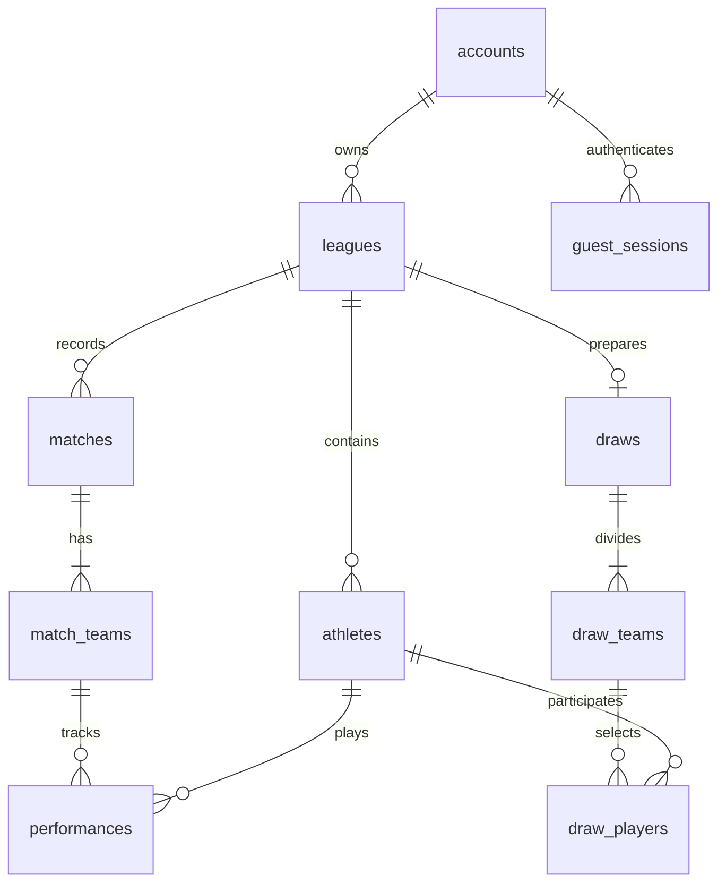

# Banco de dados do Várzuno

Cloudflare D1 (SQLite), com tabelas normalizadas, chaves estrangeiras, índices e migrações Drizzle versionadas. A tabela `peladas` da versão 1 permanece imutável para permitir recuperação dos dados antigos.

## Tabelas

| Tabela | Responsabilidade |
| --- | --- |
| `accounts` | Perfil local, tipo de conta e vínculo único com a identidade ChatGPT. Não armazena senha. |
| `guest_sessions` | Hash SHA-256 de token aleatório de 256 bits, conta convidada e expiração da sessão. |
| `auth_limits` | Limite atômico de criação de sessões de convidado por janela de conexão. Não armazena IP bruto. |
| `leagues` | Peladas independentes, proprietário, nome, revisão e marcador de migração antiga. |
| `athletes` | Atletas de cada pelada, posição, overall, ativo/arquivado. |
| `matches` | Confronto, data, local, notas textuais e gols sem autoria de cada lado. |
| `match_teams` | Dois times e seus nomes/cores no momento de cada partida. |
| `performances` | Presença, gols, assistências, nota opcional e identificação histórica do atleta. |
| `draws` | Sorteio atual de cada pelada. |
| `draw_teams` | Equipes do sorteio, preservando sua ordem. |
| `draw_players` | Atletas e ordem dentro de cada equipe sorteada. |
| `peladas` | Dados originais da versão 1, somente para importação explícita pelo proprietário. |

## Isolamento e integridade

Todos os acessos a peladas usam o proprietário resolvido no servidor. Um `owner_id` enviado pelo navegador é ignorado. Consulta, atualização, exclusão e listagem não permitem acessar outra conta. Identificadores de atletas e partidas são únicos dentro da pelada; importar o mesmo backup em outra pelada não causa colisões.

As chaves estrangeiras compostas impedem relacionar uma atuação a um atleta de outra pelada. Não é possível escalar o mesmo atleta duas vezes na mesma partida/sorteio. Exclusões em cascata ficam limitadas à pelada excluída.

O salvamento normaliza o documento validado em 11 instruções, executadas em um único `DB.batch()`, que é transacional. A primeira instrução exige a revisão anterior e grava um token exclusivo da operação. As demais instruções só executam se esse token e o proprietário coincidirem. Assim, uma revisão vencida não apaga os registros filhos. Uma falha em qualquer instrução reverte todo o lote.

Os rankings são derivados das atuações e partidas; não há contadores incrementais que dupliquem gols ao corrigir resultados. Notas zero continuam diferentes de notas não preenchidas.

## Identidade e sessões

O Sites faz o login com ChatGPT e injeta a identidade autenticada. O app não implementa OAuth, não trata callbacks do provedor e não recebe a senha do usuário. O primeiro cadastro de perfil é uma ação explícita; ler a página não cria contas.

Convidados recebem cookie `__Host-varzuno-guest`, `HttpOnly`, `Secure` e `SameSite=Lax`, válido por 30 dias. Somente o hash do token fica no banco. Ao sair, a sessão é revogada. Se não restarem peladas ou sessões, a conta de convidado vazia é removida. A perda do cookie/expiração impede recuperar esses registros sem um backup ou uma transferência anterior para conta. A expiração é de acesso, não uma promessa de exclusão física automática de dados.

Entrar com ChatGPT permite transferir explicitamente as peladas da sessão convidada presente neste navegador. A operação troca o proprietário das peladas, preservando seus dados, e revoga a antiga sessão. Ela nunca aceita o identificador de outra conta convidada como autorização.

## Importação da versão 1

Após cadastro/login, o app oferece a importação quando existe um registro `peladas.owner_id` correspondente à identidade autenticada. A importação é explícita e idempotente, com marcador único. Uma importação interrompida pode ser retomada. A cópia original não é apagada nem alterada.

## Limites operacionais

- Conta ChatGPT: até 50 peladas.
- Sessão convidada: até 5 peladas.
- Por pelada: 300 atletas, 1.000 partidas e até 2 MB por requisição/backup.
- Criação de convidados: 10 novas sessões/hora por IP informado pela infraestrutura; fallback conservador de 100/hora quando o IP não está disponível.
- Sessões e limites antigos possuem data de expiração. Não há limpeza física agendada automaticamente. Uma política de retenção e rotina administrativa podem ser configuradas conforme a operação real.

## Migrações

Não altere `0000_rare_marrow.sql` ou seus metadados: já foram aplicados. `0001_brief_avengers.sql` adiciona as tabelas normalizadas, sem apagar dados anteriores. Novas mudanças devem ser geradas com `npm run db:generate`, revisadas e publicadas pelo Sites, que aplica migrações pendentes antes de ativar o Worker.

Os testes usam SQLite real em memória com `PRAGMA foreign_keys=ON` e transações, validando permissões, rollback, isolamento, transferência, migração, expiração e conflitos de revisão.
